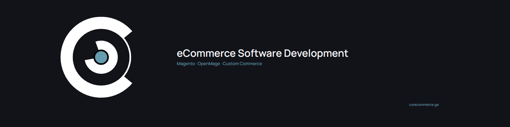

  

<h1 align="center">Marco Kriechbaumer</h1>

  <strong>eCommerce Software Development</strong> 
  CoreCommerce Technologies · Magento · OpenMage · Custom Commerce

---

I build and maintain the software that eCommerce businesses rely on: checkout and pricing logic, catalog and search behaviour, ERP and carrier integrations, performance-critical backend systems, and the custom functionality that off-the-shelf extensions cannot provide.

My strongest specialization is **Magento 1 and OpenMage LTS**, with deep experience in the underlying PHP, SQL, EAV, caching, indexing, integrations, and infrastructure that keep complex commerce platforms running reliably.

I approach eCommerce development from the backend and infrastructure up: understand the existing system, identify the real constraint, and implement the smallest robust solution that fits the platform rather than forcing unnecessary rewrites.

**CoreCommerce Technologies** focuses on eCommerce software development for businesses that need deep technical expertise rather than a general-purpose agency.

15 anonymized project write-ups, covering topics from B2B tax logic and search relevance to Varnish internals, custom indexers, and complex integrations: **[corecommerce.ge/case-studies](https://corecommerce.ge/case-studies)**

## What I Work On

| Area                                                                                      | Scope                                                                                                                                                   |
| ----------------------------------------------------------------------------------------- | ------------------------------------------------------------------------------------------------------------------------------------------------------- |
| [Platform Development](https://corecommerce.ge/services/platform-development)             | Custom module development, theme work, checkout logic, catalog functionality, and deep backend development at the EAV level                             |
| [Custom Integrations & APIs](https://corecommerce.ge/services/custom-integrations-apis)   | ERP, PIM, payment, carrier, REST and SOAP integrations, plus custom PHP APIs                                                                            |
| [Performance Optimisation](https://corecommerce.ge/services/performance-optimisation)     | Full-page cache tuning, query optimisation, indexing, profiling, and performance work across application and infrastructure layers                      |
| [Infrastructure & Hosting](https://corecommerce.ge/services/infrastructure-hosting)       | Linux, Docker Compose, Nginx, Apache, Varnish, Redis, deployment environments, and infrastructure troubleshooting                                       |
| [Maintenance & Modernisation](https://corecommerce.ge/services/maintenance-modernisation) | Root-cause analysis, technical debt reduction, staged platform upgrades, compatibility work, and incremental modernisation without unnecessary rewrites |

## Core Expertise

|                    |                                                                                       |
| ------------------ | ------------------------------------------------------------------------------------- |
| **eCommerce**      | Magento 1, OpenMage LTS                                                               |
| **Backend**        | PHP, SQL, Bash, REST/SOAP APIs, custom module development                             |
| **Frontend**       | JavaScript, TypeScript, React, Astro, HTML5, CSS3, LESS, SCSS, jQuery, Node.js        |
| **Infrastructure** | Docker, Linux (Ubuntu/Debian), Nginx, Apache, Varnish, Redis, CI/CD, Git, VMware, VPN |
| **Data**           | MySQL, MariaDB                                                                        |
| **Enterprise**     | Active Directory, Exchange Server, DATEV                                              |

## Currently

Accepting new eCommerce development projects.

Most of my work centres on **custom backend business logic and feature development for B2B and B2C commerce platforms**: checkout flows, pricing and tax rules, catalog and search behaviour, ERP and carrier integrations, and platform-specific functionality.

I also work on the engineering around those systems where necessary, including performance analysis, infrastructure, CI/CD, static analysis, and upgrade safety for OpenMage LTS codebases.

## Get In Touch

* **Website** · [corecommerce.ge](https://corecommerce.ge/)
* **Email** · [info@corecommerce.ge](mailto:info@corecommerce.ge)
* **WhatsApp** · [+995 599 100 583](https://wa.me/995599100583)
* **LinkedIn** · [marco-kriechbaumer](https://www.linkedin.com/in/marco-kriechbaumer)

CoreCommerce Technologies · Ecommerce Development and IT Services · Tbilisi, Georgia
